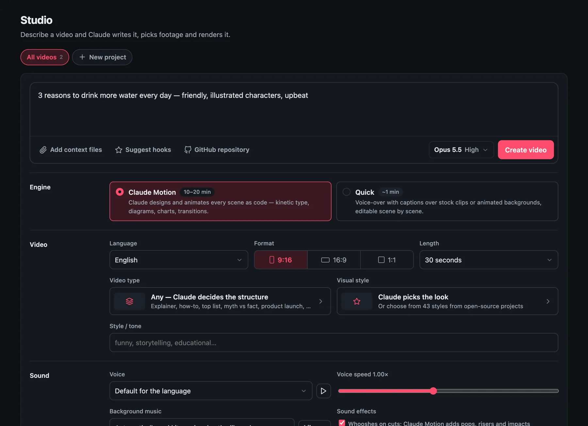
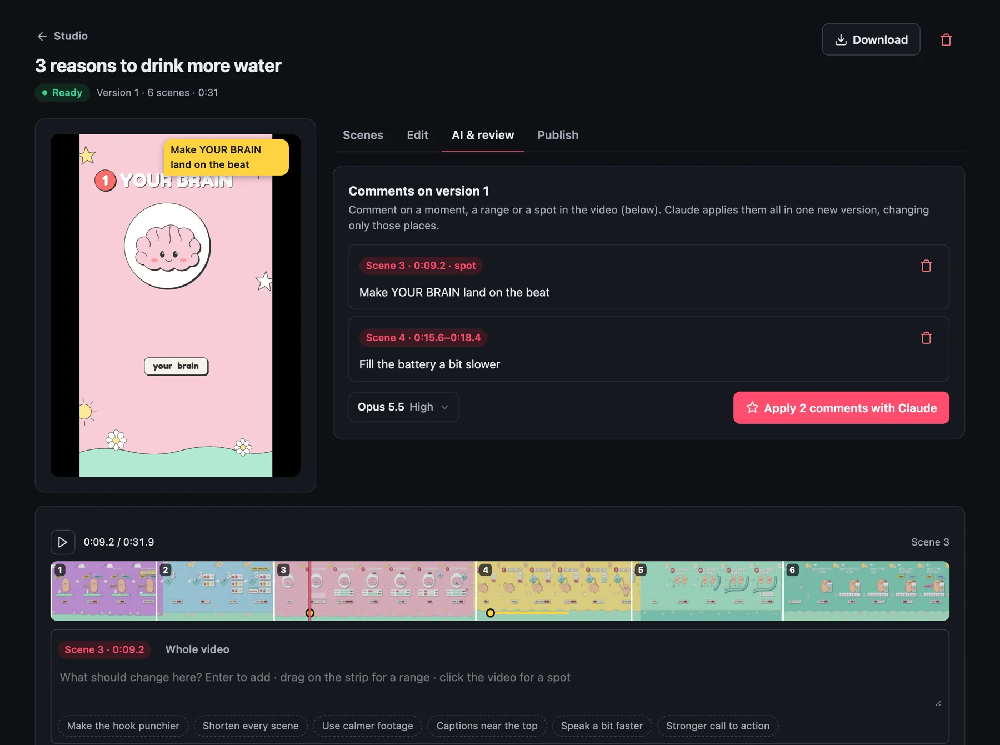
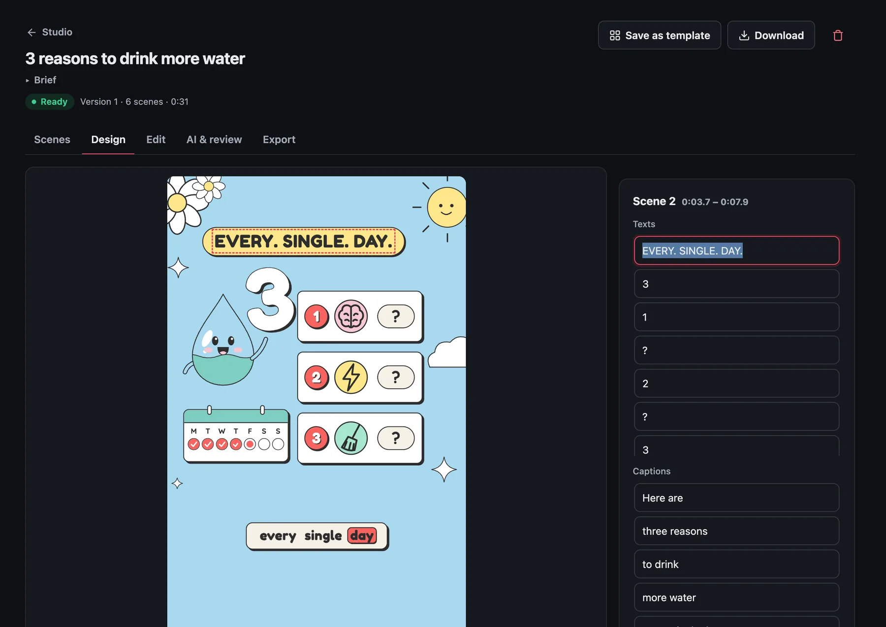
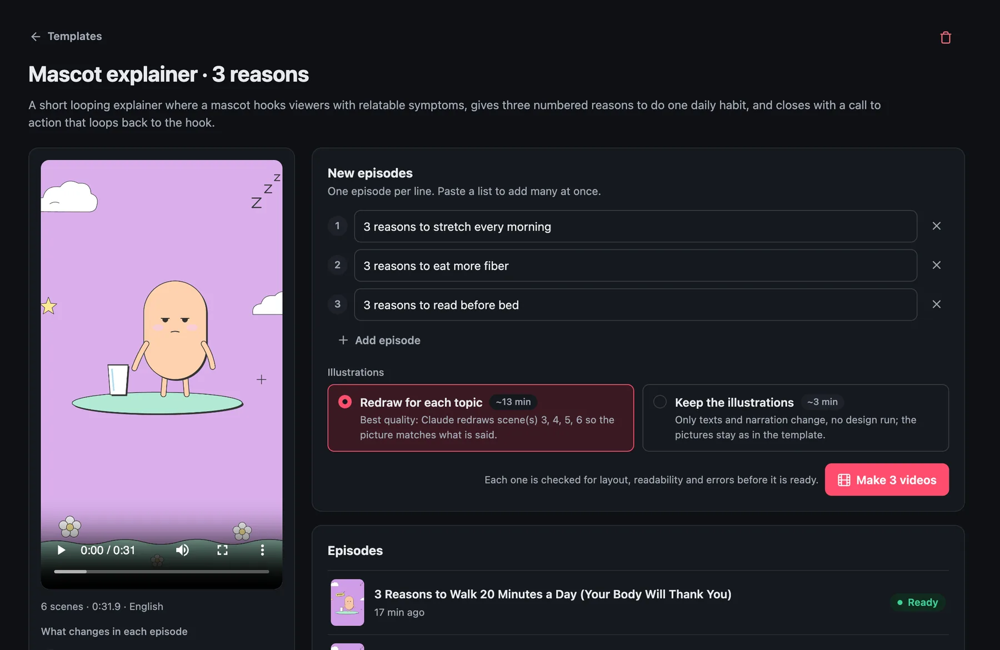

<h1 align="center">
  <picture>
    <source media="(prefers-color-scheme: dark)" srcset="docs/logo-dark.svg">
    
  </picture>
</h1>

<p align="center">
  <a href="https://autoclip-connect.thihodev.workers.dev"><b>Website</b></a> ·
  <a href="#quick-start">Quick start</a> ·
  <a href="docs/API.md">API</a> ·
  <a href="CONTRIBUTING.md">Contributing</a> ·
  <a href="LICENSE">MIT</a>
</p>

**Open-source studio that turns a topic, a website or a GitHub repo into a finished short video — written, voiced, designed and animated by Claude, then edited by you — and turns the videos you like into templates for a whole series. A web UI for everything.**

Make YouTube Shorts, TikToks, Facebook Reels or 16:9 YouTube videos; review them frame by frame; let Claude apply your comments; change any text, image, caption, font or color yourself, checked for layout and readability before each render; save a video as a template and make the next episodes from a list, in minutes and without designing again; export the video — or its layers for CapCut, Premiere and DaVinci — with a caption, hashtags and a cover. It runs on your own computer and uses your own Claude account (subscription or API key). No `.env`, no Docker: every connection is made from the UI.

<p align="center">
  
  
</p>
<p align="center">
  
  
</p>
<p align="center"><sub>Describe it · review it frame by frame · change it yourself · make the series — see the <a href="https://autoclip-connect.thihodev.workers.dev">website</a> for a tour.</sub></p>

```
 topic · website · GitHub repo · your files
        │
        ▼
 Claude (Agent SDK) ── video type (structure) + visual style (look) + brand kit + hook
        │
        ├─ Claude Motion: designs and animates every scene as code (HyperFrames)   ~10–20 min
        └─ Quick: voice-over + word captions over stock clips or animated backgrounds  ~1 min
        │
        ▼
 voice (ElevenLabs / free edge-tts) · music bed (ducked) · sound effects · captions
        │
        ▼
 review: comment on a moment, a range or a spot ─► Claude applies the round ─► next version
        │
        ▼
 design (Motion, live: texts · images · captions · fonts · colors · pauses, quality check) · timeline editor ─► export: MP4 · layers (CapCut, Premiere, DaVinci) · caption · cover
        │
        ▼
 save as template ─► next episodes, one per line: new words, voice and captions in the same design (~3 min, no design run) ─► checked ─► ready
```

## Quick start

```bash
git clone https://github.com/thihodev/autoclip-studio.git && cd autoclip-studio
./start.sh          # Windows: start.cmd
```

The first run creates `.venv`, installs dependencies (with [uv](https://github.com/astral-sh/uv) when available, otherwise pip) and opens http://localhost:8000. After `git pull`, run `./start.sh` again — it reinstalls only when `requirements.txt` changed. Use `./start.sh --no-browser` on a server.

**Requirements:** Python 3.11+. For the Claude Motion engine also Node.js 22+ and FFmpeg (installed from the UI in one click: HyperFrames, its skills and Chrome).

Then open **Connections** and connect Claude — the only required step.

## Connections

Connections is a short list; click a row for its settings.

| Connection | Required | What it gives you |
|---|---|---|
| **Claude** | yes | Sign in with Claude here (a separate login stored in `data/claude/`), use this computer's Claude Code login, or an Anthropic API key. Several can be saved and switched without signing in again. The app never picks an account by itself. |
| Claude Motion | | One-click install of [HyperFrames](https://github.com/heygen-com/hyperframes) for the motion engine. |
| Voice-over | | An [ElevenLabs](https://elevenlabs.io) key for natural voices in 70+ languages (incl. Vietnamese). Without it, free Microsoft voices (edge-tts). The key needs *Text to Speech* and *Voices → Read*. |
| Music & sound effects | | A music library (upload tracks with a mood, or generate them with ElevenLabs Music) and AutoClip's built-in sound effects. |
| Stock footage | | A free [Pixabay](https://pixabay.com/api/docs/) key (or an existing Pexels key) for real clips in Quick videos. Without it, animated backgrounds in your brand colors. |
| GitHub | | A fine-grained token with read-only *Contents* to use private repositories. Public repos work without it. |

> ⚠️ Use a Claude subscription for **yourself only**. Agent SDK usage on subscription plans draws from your plan's monthly Agent SDK credit; for multi-user setups each person connects their own account or uses an API key. See the [authentication docs](https://code.claude.com/docs/en/authentication). Web sign-in drives `claude auth login` in a pseudo-terminal (macOS and Linux; on Windows use this computer's login or an API key).

## Making a video

In **Studio**, describe the video and choose:

- **Source** (optional): context files (articles, notes, docs, transcripts — TXT, MD, PDF, DOCX, HTML, CSV, JSON, SRT/VTT), a **GitHub repository** (Claude reads its description, README and latest release; the topic can stay empty), or a **website** named in the topic (Claude reads the site and builds a brand kit from it).
- **Engine**: Claude Motion (default) or Quick — see below.
- **Video type** — the structure (hook, beats, pacing, ending), from 11 playbooks: AutoClip's *Top N list*, *Myth vs fact*, *Story / case study*, and [FrameJam](https://github.com/moritzkremb/framejam)'s faceless ones (*Explainer, How-to, Math animation, Motion showreel, Product launch, Launch teaser, Timeline, YouTube intro*).
- **Visual style** (Claude Motion) — the look, from a gallery of 43: 30 FrameJam styles (palette, fonts, easing, transitions, text animations, pacing, with posters) and the 13 HyperFrames frame presets.
- **Hook**: *Suggest hooks* gives 3 opening lines from different angles; pick one, and optionally make a **B version** with another hook to compare.
- **Brand kit**, language, format (9:16, 16:9, 1:1), length, tone, voice (with ▶ preview — ElevenLabs voices when connected — or *no voice-over*: captions timed to reading speed, music turned up), **background music** and **sound effects**.
- **Model & effort** for this video (a Claude-style menu next to *Create video*).

The composer remembers its choices for the next video.

## Engines

| | Claude Motion (default) | Quick |
|---|---|---|
| How | A Claude agent runs HyperFrames' `faceless-explainer` workflow: storyboard and script, voice-over, one sub-agent designs and animates each scene (HTML + GSAP, with GreenSock's official GSAP skills for SplitText, DrawSVG, MorphSVG…), visual QA on every frame, render | Claude writes the scenes; voice-over and word-by-word captions over stock clips, brand b-roll or animated backgrounds; ffmpeg |
| Time | ~10–20 min | ~1 min |
| Sound | Music bed + sound-effect cues placed by the agent | Music bed + a whoosh on every cut |
| Editing | Review comments and instructions; Claude re-animates only what you point at | Scene-by-scene editor, footage swap, caption styles, AI edits |

Claude Motion is token-heavy. Quality comes first — the orchestrator and the scene designers run on Opus at high effort by default (both configurable in Connections → Claude, e.g. Sonnet designers to spend about half) — and it is built not to waste: it never idles waiting for sub-agents, keeps its context small and only gets the tools it needs. The usage page shows what each video used.

HyperFrames' skill installer normally writes into your global agent folders (`~/.claude/skills`, …). AutoClip never lets it: skills are installed into `data/hyperframes/` with an app-owned `HOME`, and the agent runs with a command allow/deny policy, file writes limited to its project folder and no web access.

## Review and edit

Open a video's **AI & review** tab: the player gets a full-width filmstrip split by scene.

- Pause and type to comment on **the current moment**, drag across the filmstrip for **a range**, click the video to pin **a spot**, or comment on the **whole video**. Comments show on the video as it plays past them.
- **Apply with Claude** sends the round as one edit — each comment with its scene number and time, and for Claude Motion the frame with the spot marked. Claude changes only those places and renders the next version.
- Keys: `Space` play/pause, `←/→` one frame, `Shift+←/→` one second, `C` comment.

The **Scenes** and **Style** tabs (Quick engine) edit text, footage, captions, voice and brand elements by hand. Every render is kept as a version you can preview.

The **Design** tab (Claude Motion) edits the video Claude built directly, without running Claude again. The HyperFrames composition plays live in the browser, and you click what you want to change:

- **Texts** — retype them; a text that no longer fits (off the video, out of its box, under TikTok's buttons) is flagged at once with a **Fit** button that sizes it back.
- **Images and videos** — replace them with your own (as before, fill, or fit inside), once or everywhere the file is used, e.g. a logo. A picture smaller than its place is flagged before it goes in, since it would look soft.
- **Captions** — fix their wording; the word timing is kept (or shared out again when the word count changes).
- **Fonts** — swap a font for one of 24 Google Fonts that all cover Vietnamese; the preview flags letters the current font doesn't have, and the new font's weight is matched to how thick the old one looked.
- **Colors** — swap one everywhere, captions included. **Pauses** — add up to 5 s after a scene's narration; everything after it moves along.

Changes show at once, with undo (⌘Z) and **Discard**. **Render new version** first runs HyperFrames' check (layout, contrast, errors) and lists only the problems your changes brought in — compared with the same check on the version you started from — then renders with HyperFrames (about 3 seconds per second of video on a laptop, no Claude usage). Texts drawn by scripts (counters, for example), the narration and the layout still go through Claude in **AI & review**.

The **Edit** tab is a CapCut-style timeline that works on any version, Claude Motion videos included: split (S), trim by dragging a clip's edges, reorder by dragging, delete, duplicate, speed (0.5–3×) and volume per clip, looks (Vivid, Warm, Faded, Film, Mono, Noir) with brightness, contrast and saturation; titles you drag into place on the video with size, color, outline/box/shadow and fade/pop/slide/typewriter animations; a music track from your library with volume and fades; undo/redo (⌘Z). The preview plays it live, the edit autosaves, and **Export** renders it with ffmpeg as a new version — the original is kept.

To finish a video in another editor, **Export → Layers for editing** makes a ZIP that CapCut, Premiere, DaVinci Resolve and Final Cut all import: each scene as its own clip without captions, the captions (and logo) on a transparent ProRes 4444 layer, voice / music / SFX as separate WAVs, the captions as SRT, and a `timeline.fcpxml` with everything in place (Claude Motion adds the whole video without captions). Quick videos are rebuilt in seconds; Claude Motion videos are re-rendered from their HyperFrames project, one composition per layer, in a few minutes — no Claude needed.

## Export

The **Export** tab works on the version you pick at its top (the one the player shows; the latest by default):

- **Download** that version (and the chosen cover); on a phone, *Share* hands the file to any app.
- **Layers for editing** — the ZIP described above, for CapCut, Premiere, DaVinci Resolve and Final Cut. Layers are always made from the latest version made by Claude or the Design tab (the project's sources describe that one), and the tab says which.
- **Caption & hashtags** — Claude writes the title, caption, hashtags and keywords from what the video actually says; edit, save and copy them when you post.
- **Cover image** — three covers from different moments with big text in the brand's font and accent color; pick one to download.

AutoClip doesn't connect to social networks or post for you: it focuses on making and editing the video, and you post it wherever you like.

## Templates: design once, make a series

Claude designs a video once; **Save as template** turns it into a format for a series. Claude reads the scenes once (one small call) and marks each one:

- **Fixed** — the same in every episode (brand intro, call to action): visuals, texts and narration are kept.
- **Fill in** — the content is in the texts: an episode gets new texts and narration in the same design.
- **Redraw** — the illustration belongs to the topic (a drawn brain for "your brain").

Then pick it from **Templates** in the sidebar or from **Start from a template** above the Studio composer (a topic typed there becomes its next episode), and type what the next episodes are about, one per line (or paste a list). Episodes keep the template's language and voice. For each one Claude writes the narration and the on-screen texts, sized to the template's slots (one small call); the voice is recorded and the workflow's own scripts re-time the video — captions, assembly and transitions — without an agent run. With **Redraw for each topic** (the default when a template has such scenes) Claude Motion redraws only those scenes in the template's style; **Keep the illustrations** skips it. Every episode is checked with HyperFrames before it is ready, against the same check run once on the template, so only problems the new content brought in are reported (in the video's page and its Design tab). On a laptop a 30-second episode takes about 3 minutes without redrawing, about 13 when Claude Motion redraws four scenes.

Episodes are ordinary videos: edit them in the Design tab, ask Claude for changes, export them, or save one as a new template.

## Brand kits

A brand kit is a design system for videos: description, voice and tone, audience, call to action, knowledge files, colors, caption style, font, logo, intro/outro, music and a b-roll library. Claude follows it when writing and designing; the renderer applies its assets.

- **Import from a website** — headless Chrome captures the site; Claude picks colors, fonts, logo, copy and real product images.
- **Import from GitHub** — uses `autoclip.brand.json` when the repo has one ([example](examples/autoclip.brand.json)); otherwise Claude reads the README, styles and design tokens. Pick the repository and branch from menus; *Sync* re-imports.

## Also included

- **Projects** — group videos per product or channel with a shared website, brand kit, instructions and context files.
- **Ideas** — topic suggestions for a niche, each with a hook. **Autopilot** — every N hours: ideas → videos, waiting in Studio for you.
- **Live view** — what Claude is doing right now, with the latest frame it looked at; a corner dock tracks running videos.
- **Usage** — on a Claude plan: the 5-hour session and weekly limits (as `/usage` in Claude Code shows them) plus tokens and time; with an API key: what you pay. Each video shows its own usage.
- **Complete deletes** — deleting a video stops its job and removes every file it owns; leftovers from older versions can be reviewed and removed.
- **English and Vietnamese UI**, light and dark themes.

## Configuration and safety

Everything lives in `data/` (`autoclip.db` for settings and projects, renders, brand kits, music). Optional environment variables (or a `.env` file): `HOST`, `PORT`, `DATA_DIR`.

> The app has no login of its own. Keep it on `127.0.0.1` (the default) or put it behind your own authentication before exposing it.

## Project layout

| Path | What's there |
|---|---|
| `app/main.py` | FastAPI routes ([API reference](docs/API.md)) |
| `app/pipeline.py` | Video jobs: create, render versions, AI edits, review rounds, design and timeline edits, layers, autopilot |
| `app/claude.py` · `app/usage.py` | Claude via the Agent SDK (scripts, ideas, edits, hooks, post copy, sign-in) · usage metering and plan limits |
| `app/motion.py` | Claude Motion engine (HyperFrames agent, voice-over tool, rules) |
| `app/render.py` · `app/tts.py` · `app/audio.py` · `app/covers.py` | Quick engine (ffmpeg) · voices · music and sound effects · cover images |
| `app/brands.py` · `app/styles.py` · `app/playbooks.py` | Brand kits and imports · visual styles · video types |
| `app/design.py` · `app/editor.py` · `app/layers.py` | Direct edits to Claude Motion projects · the timeline editor's export · layers for other editors |
| `app/templates.py` | Templates: a Claude Motion video as a series format, and its episodes |
| `static/index.html` · `static/locales/` | The whole UI (Alpine.js) · translations |
| `website/` | The [website](https://autoclip-connect.thihodev.workers.dev): static files on Cloudflare Workers |
| `app/assets/` | Bundled font, FrameJam styles and playbooks, GSAP skills (with their licenses), AutoClip playbooks |

## Contributing

Contributions are welcome — through pull requests; `main` is protected. Read [CONTRIBUTING.md](CONTRIBUTING.md) (setup, conventions, how to add a language, a visual style or a video type). AI coding agents follow [CLAUDE.md](CLAUDE.md).

## Roadmap ideas

- More voices: [Kokoro](https://github.com/hexgrad/kokoro), [F5-TTS](https://github.com/SWivid/F5-TTS) (voice cloning); dubbing a video into other languages.
- One video → several formats (9:16 ↔ 16:9 ↔ 1:1).
- Templates with per-episode images and data columns (a spreadsheet of episodes), and a template gallery to share.
- Retention-aware edits: read a TikTok retention graph and fix the scene where viewers swipe away.
- AI-generated shots (ComfyUI + Wan / LTX-Video); clipping long videos into shorts.
- Docker image; resuming jobs after a restart.

## License and credits

[MIT](LICENSE). Bundled: [Be Vietnam Pro](app/assets/fonts/OFL.txt) (SIL OFL); [FrameJam](https://github.com/moritzkremb/framejam) styles and playbooks (MIT, `app/assets/*/framejam/LICENSE`), whose review page also inspired AutoClip's; GreenSock's [GSAP skills](https://github.com/greensock/gsap-skills) (MIT, `app/assets/skills/gsap/LICENSE`). Used from their own installs: [HyperFrames](https://github.com/heygen-com/hyperframes) (Apache-2.0), the [Claude Agent SDK](https://github.com/anthropics/claude-agent-sdk-python), [edge-tts](https://github.com/rany2/edge-tts), FFmpeg via [imageio-ffmpeg](https://github.com/imageio/imageio-ffmpeg).
