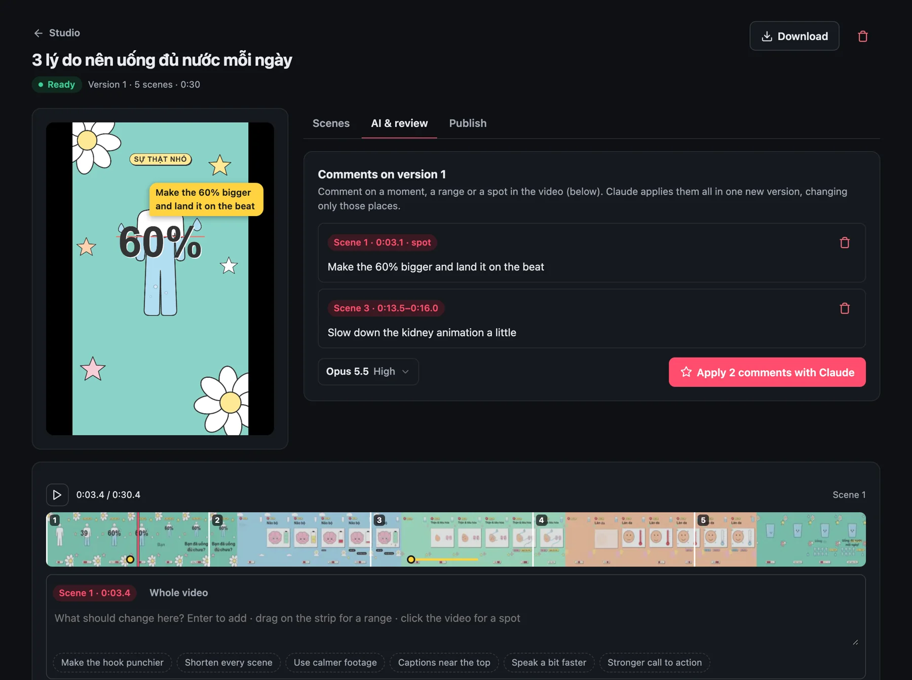
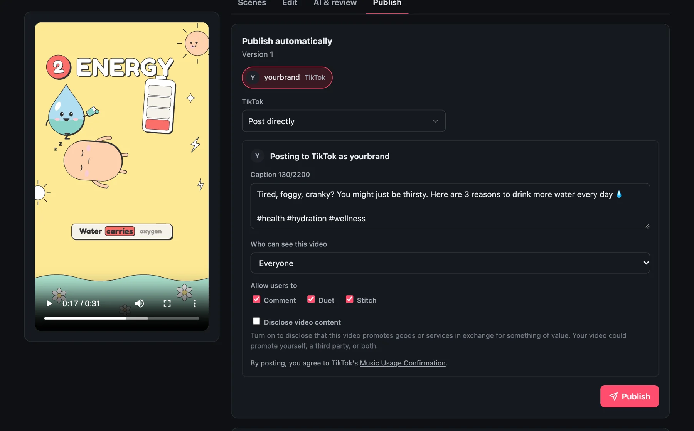

<h1 align="center">
  <picture>
    <source media="(prefers-color-scheme: dark)" srcset="docs/logo-dark.svg">
    
  </picture>
</h1>

<p align="center">
  <a href="https://autoclip-connect.thihodev.workers.dev"><b>Website</b></a> ·
  <a href="#quick-start">Quick start</a> ·
  <a href="docs/API.md">API</a> ·
  <a href="CONTRIBUTING.md">Contributing</a> ·
  <a href="LICENSE">MIT</a>
</p>

**Open-source studio that turns a topic, a website or a GitHub repo into a finished short video — written, voiced, designed, animated and published by Claude — with a web UI for everything.**

Make YouTube Shorts, TikToks, Facebook Reels or 16:9 YouTube videos; review them frame by frame; let Claude apply your comments; publish with title, caption, hashtags and cover. It runs on your own computer and uses your own Claude account (subscription or API key). No `.env`, no Docker: every connection is made from the UI.

<p align="center">
  
  
  
</p>
<p align="center"><sub>Describe it · review it frame by frame · post it — see the <a href="https://autoclip-connect.thihodev.workers.dev">website</a> for a tour.</sub></p>

```
 topic · website · GitHub repo · your files
        │
        ▼
 Claude (Agent SDK) ── video type (structure) + visual style (look) + brand kit + hook
        │
        ├─ Claude Motion: designs and animates every scene as code (HyperFrames)   ~10–20 min
        └─ Quick: voice-over + word captions over stock clips or animated backgrounds  ~1 min
        │
        ▼
 voice (ElevenLabs / free edge-tts) · music bed (ducked) · sound effects · captions
        │
        ▼
 review: comment on a moment, a range or a spot ─► Claude applies the round ─► next version
        │
        ▼
 post copy + cover ─► YouTube · TikTok · Facebook · Postiz
```

## Quick start

```bash
git clone https://github.com/thihodev/autoclip-studio.git && cd autoclip-studio
./start.sh          # Windows: start.cmd
```

The first run creates `.venv`, installs dependencies (with [uv](https://github.com/astral-sh/uv) when available, otherwise pip) and opens http://localhost:8000. After `git pull`, run `./start.sh` again — it reinstalls only when `requirements.txt` changed. Use `./start.sh --no-browser` on a server.

**Requirements:** Python 3.11+. For the Claude Motion engine also Node.js 22+ and FFmpeg (installed from the UI in one click: HyperFrames, its skills and Chrome).

Then open **Connections** and connect Claude — the only required step.

## Connections

Connections is a short list; click a row for its settings.

| Connection | Required | What it gives you |
|---|---|---|
| **Claude** | yes | Sign in with Claude here (a separate login stored in `data/claude/`), use this computer's Claude Code login, or an Anthropic API key. Several can be saved and switched without signing in again. The app never picks an account by itself. |
| Claude Motion | | One-click install of [HyperFrames](https://github.com/heygen-com/hyperframes) for the motion engine. |
| Voice-over | | An [ElevenLabs](https://elevenlabs.io) key for natural voices in 70+ languages (incl. Vietnamese). Without it, free Microsoft voices (edge-tts). The key needs *Text to Speech* and *Voices → Read*. |
| Music & sound effects | | A music library (upload tracks with a mood, or generate them with ElevenLabs Music) and AutoClip's built-in sound effects. |
| Stock footage | | A free [Pixabay](https://pixabay.com/api/docs/) key (or an existing Pexels key) for real clips in Quick videos. Without it, animated backgrounds in your brand colors. |
| TikTok (one click) | | Through [AutoClip Connect](services/connect/) — sign in to TikTok and approve, no developer app. It only completes the sign-in and renews access; nothing is stored there and videos upload from your computer. Runs at [autoclip-connect.thihodev.workers.dev](https://autoclip-connect.thihodev.workers.dev); the button appears by itself once its TikTok app is set up (`AUTOCLIP_CONNECT_URL` points AutoClip at another Connect, or `""` turns it off). |
| Postiz | | The easiest way to post automatically: paste your [Postiz Cloud](https://postiz.com) API key and publish to TikTok, YouTube, Instagram, Facebook, LinkedIn, X, Threads… with no developer app (a self-hosted Postiz takes its URL too). |
| YouTube · TikTok · Facebook | | Advanced: your own developer app per platform; the dialog shows the redirect URI to register. |
| GitHub | | A fine-grained token with read-only *Contents* to use private repositories. Public repos work without it. |
| Public URL | | A tunnel URL (e.g. `cloudflared tunnel --url http://localhost:8000`) — TikTok needs HTTPS redirects. |

> ⚠️ Use a Claude subscription for **yourself only**. Agent SDK usage on subscription plans draws from your plan's monthly Agent SDK credit; for multi-user setups each person connects their own account or uses an API key. See the [authentication docs](https://code.claude.com/docs/en/authentication). Web sign-in drives `claude auth login` in a pseudo-terminal (macOS and Linux; on Windows use this computer's login or an API key).

## Making a video

In **Studio**, describe the video and choose:

- **Source** (optional): context files (articles, notes, docs, transcripts — TXT, MD, PDF, DOCX, HTML, CSV, JSON, SRT/VTT), a **GitHub repository** (Claude reads its description, README and latest release; the topic can stay empty), or a **website** named in the topic (Claude reads the site and builds a brand kit from it).
- **Engine**: Claude Motion (default) or Quick — see below.
- **Video type** — the structure (hook, beats, pacing, ending), from 11 playbooks: AutoClip's *Top N list*, *Myth vs fact*, *Story / case study*, and [FrameJam](https://github.com/moritzkremb/framejam)'s faceless ones (*Explainer, How-to, Math animation, Motion showreel, Product launch, Launch teaser, Timeline, YouTube intro*).
- **Visual style** (Claude Motion) — the look, from a gallery of 43: 30 FrameJam styles (palette, fonts, easing, transitions, text animations, pacing, with posters) and the 13 HyperFrames frame presets.
- **Hook**: *Suggest hooks* gives 3 opening lines from different angles; pick one, and optionally make a **B version** with another hook to compare.
- **Brand kit**, language, format (9:16, 16:9, 1:1), length, tone, voice (with ▶ preview — ElevenLabs voices when connected — or *no voice-over*: captions timed to reading speed, music turned up), **background music** and **sound effects**, publishing targets.
- **Model & effort** for this video (a Claude-style menu next to *Create video*).

The composer remembers its choices for the next video.

## Engines

| | Claude Motion (default) | Quick |
|---|---|---|
| How | A Claude agent runs HyperFrames' `faceless-explainer` workflow: storyboard and script, voice-over, one sub-agent designs and animates each scene (HTML + GSAP, with GreenSock's official GSAP skills for SplitText, DrawSVG, MorphSVG…), visual QA on every frame, render | Claude writes the scenes; voice-over and word-by-word captions over stock clips, brand b-roll or animated backgrounds; ffmpeg |
| Time | ~10–20 min | ~1 min |
| Sound | Music bed + sound-effect cues placed by the agent | Music bed + a whoosh on every cut |
| Editing | Review comments and instructions; Claude re-animates only what you point at | Scene-by-scene editor, footage swap, caption styles, AI edits |

Claude Motion is token-heavy. Quality comes first — the orchestrator and the scene designers run on Opus at high effort by default (both configurable in Connections → Claude, e.g. Sonnet designers to spend about half) — and it is built not to waste: it never idles waiting for sub-agents, keeps its context small and only gets the tools it needs. The usage page shows what each video used.

HyperFrames' skill installer normally writes into your global agent folders (`~/.claude/skills`, …). AutoClip never lets it: skills are installed into `data/hyperframes/` with an app-owned `HOME`, and the agent runs with a command allow/deny policy, file writes limited to its project folder and no web access.

## Review and edit

Open a video's **AI & review** tab: the player gets a full-width filmstrip split by scene.

- Pause and type to comment on **the current moment**, drag across the filmstrip for **a range**, click the video to pin **a spot**, or comment on the **whole video**. Comments show on the video as it plays past them.
- **Apply with Claude** sends the round as one edit — each comment with its scene number and time, and for Claude Motion the frame with the spot marked. Claude changes only those places and renders the next version.
- Keys: `Space` play/pause, `←/→` one frame, `Shift+←/→` one second, `C` comment.

The **Scenes** and **Style** tabs (Quick engine) edit text, footage, captions, voice and brand elements by hand. Every render is kept as a version you can preview.

The **Edit** tab is a CapCut-style timeline that works on any version, Claude Motion videos included: split (S), trim by dragging a clip's edges, reorder by dragging, delete, duplicate, speed (0.5–3×) and volume per clip, looks (Vivid, Warm, Faded, Film, Mono, Noir) with brightness, contrast and saturation; titles you drag into place on the video with size, color, outline/box/shadow and fade/pop/slide/typewriter animations; a music track from your library with volume and fades; undo/redo (⌘Z). The preview plays it live, the edit autosaves, and **Export** renders it with ffmpeg as a new version — the original is kept.

To finish a video in another editor, **Publish → Layers for editing** makes a ZIP that CapCut, Premiere, DaVinci Resolve and Final Cut all import: each scene as its own clip without captions, the captions (and logo) on a transparent ProRes 4444 layer, voice / music / SFX as separate WAVs, the captions as SRT, and a `timeline.fcpxml` with everything in place (Claude Motion adds the whole video without captions). Quick videos are rebuilt in seconds; Claude Motion videos are re-rendered from their HyperFrames project, one composition per layer, in a few minutes — no Claude needed.

## Publish

The **Publish** tab:

- **Post it yourself** — no connection needed: download the video and cover, copy a caption made for TikTok, YouTube Shorts (title + description), Instagram Reels or Facebook Reels, and open each app's upload page. On a phone, *Share to an app* sends the file straight to the TikTok, Instagram or YouTube app.
- **Post copy** — Claude writes the title, caption, hashtags and YouTube tags from what the video actually says; edit and save.
- **Cover image** — three covers from different moments with big text in the brand's font and accent color. The chosen one becomes the YouTube thumbnail (landscape videos; needs a verified channel) and its moment the TikTok cover.
- **Publish automatically** through Postiz Cloud (just its API key, no developer app) or, with your own developer apps, straight to YouTube, TikTok (direct or as a draft), Facebook Pages (vertical videos as Reels) and Postiz channels. AI-generated content is labeled where supported (`containsSyntheticMedia`, `is_aigc`).

| Platform | Developer app | Notes |
|---|---|---|
| YouTube | Google Cloud → YouTube Data API v3 → OAuth client (Web) | Unverified apps upload as private until Google audits the app. |
| TikTok | developers.tiktok.com app with Login Kit + Content Posting API | HTTPS redirect (set a Public URL). Unaudited apps post privately only. |
| Facebook | Meta app with Facebook Login for Business | `pages_show_list`, `pages_read_engagement`, `pages_manage_posts`. |

## Brand kits

A brand kit is a design system for videos: description, voice and tone, audience, call to action, knowledge files, colors, caption style, font, logo, intro/outro, music and a b-roll library. Claude follows it when writing and designing; the renderer applies its assets.

- **Import from a website** — headless Chrome captures the site; Claude picks colors, fonts, logo, copy and real product images.
- **Import from GitHub** — uses `autoclip.brand.json` when the repo has one ([example](examples/autoclip.brand.json)); otherwise Claude reads the README, styles and design tokens. Pick the repository and branch from menus; *Sync* re-imports.

## Also included

- **Projects** — group videos per product or channel with a shared website, brand kit, instructions and context files.
- **Ideas** — topic suggestions for a niche, each with a hook. **Autopilot** — every N hours: ideas → render → optional auto-publish.
- **Live view** — what Claude is doing right now, with the latest frame it looked at; a corner dock tracks running videos.
- **Usage** — on a Claude plan: the 5-hour session and weekly limits (as `/usage` in Claude Code shows them) plus tokens and time; with an API key: what you pay. Each video shows its own usage.
- **Complete deletes** — deleting a video stops its job and removes every file it owns; leftovers from older versions can be reviewed and removed.
- **English and Vietnamese UI**, light and dark themes.

## Configuration and safety

Everything lives in `data/` (`autoclip.db` for settings and projects, renders, brand kits, music). Optional environment variables (or a `.env` file): `HOST`, `PORT`, `DATA_DIR`.

> The app has no login of its own. Keep it on `127.0.0.1` (the default) or put it behind your own authentication before exposing it.

## Project layout

| Path | What's there |
|---|---|
| `app/main.py` | FastAPI routes ([API reference](docs/API.md)) |
| `app/pipeline.py` | Video jobs: create, render versions, AI edits, review rounds, publishing, autopilot |
| `app/claude.py` · `app/usage.py` | Claude via the Agent SDK (scripts, ideas, edits, hooks, post copy, sign-in) · usage metering and plan limits |
| `app/motion.py` | Claude Motion engine (HyperFrames agent, voice-over tool, rules) |
| `app/render.py` · `app/tts.py` · `app/audio.py` · `app/covers.py` | Quick engine (ffmpeg) · voices · music and sound effects · cover images |
| `app/brands.py` · `app/styles.py` · `app/playbooks.py` | Brand kits and imports · visual styles · video types |
| `app/platforms.py` · `app/postiz.py` | YouTube, TikTok, Facebook OAuth and publishing · Postiz |
| `static/index.html` · `static/locales/` | The whole UI (Alpine.js) · translations |
| `services/connect/` | AutoClip Connect: a tiny Cloudflare Worker holding the TikTok app for one-click sign-in; it also serves the [website](https://autoclip-connect.thihodev.workers.dev) (`public/`) |
| `app/assets/` | Bundled font, FrameJam styles and playbooks, GSAP skills (with their licenses), AutoClip playbooks |

## Contributing

Contributions are welcome — through pull requests; `main` is protected. Read [CONTRIBUTING.md](CONTRIBUTING.md) (setup, conventions, how to add a language, a visual style or a video type). AI coding agents follow [CLAUDE.md](CLAUDE.md).

## Roadmap ideas

- More voices: [Kokoro](https://github.com/hexgrad/kokoro), [F5-TTS](https://github.com/SWivid/F5-TTS) (voice cloning); dubbing a video into other languages.
- One video → several formats (9:16 ↔ 16:9 ↔ 1:1) and SRT export.
- A brand's design system generated once and reused, for consistency and fewer tokens.
- Platform analytics feeding back into Ideas and Autopilot.
- AI-generated shots (ComfyUI + Wan / LTX-Video); clipping long videos into shorts.
- Docker image; resuming jobs after a restart.

## License and credits

[MIT](LICENSE). Bundled: [Be Vietnam Pro](app/assets/fonts/OFL.txt) (SIL OFL); [FrameJam](https://github.com/moritzkremb/framejam) styles and playbooks (MIT, `app/assets/*/framejam/LICENSE`), whose review page also inspired AutoClip's; GreenSock's [GSAP skills](https://github.com/greensock/gsap-skills) (MIT, `app/assets/skills/gsap/LICENSE`). Used from their own installs: [HyperFrames](https://github.com/heygen-com/hyperframes) (Apache-2.0), the [Claude Agent SDK](https://github.com/anthropics/claude-agent-sdk-python), [edge-tts](https://github.com/rany2/edge-tts), FFmpeg via [imageio-ffmpeg](https://github.com/imageio/imageio-ffmpeg). Postiz is used over its API and keeps its own license.
